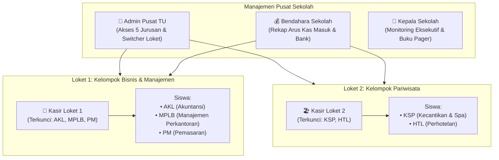

# BUKU PANDUAN PENGGUNAAN SISTEM (USER MANUAL)
## SITAMPAN SMK — Sistem Informasi Tagihan & Manajemen Pembayaran Keuangan SMK
**Pengembang:** CV. ISTANA BARCODE COMPUTER — DEVELOPER CERDAS  
**Versi Sistem:** 2.0 (Multi-Jurusan & Multi-Kasir Berbasis Rombel)

---

## 1. PENDAHULUAN & ARSITEKTUR LOKET

SITAMPAN SMK dirancang khusus untuk mempermudah tata kelola keuangan sekolah menengah kejuruan (SMK) dengan karakteristik rombel banyak dan jurusan yang beragam.

Sistem membagi operasional keuangan ke dalam **2 Kelompok Bidang Kejuruan** yang dilayani oleh **2 Kasir Loket Khusus**, serta dipantau penuh oleh **Admin Pusat**, **Bendahara**, dan **Kepala Sekolah**.

---

## 2. DAFTAR AKUN & HAK AKSES PENGGUNA

| Akun / Peran | Username | Password Default | Wilayah Layanan / Batasan Akses |
| :--- | :--- | :--- | :--- |
| 💼 **Kasir Loket 1 (Bisnis & Manajemen)** | `hana` | `hana123` | **Terkunci khusus Kelompok Bisnis & Manajemen.** Hanya melayani siswa `AKL`, `MPLB`, dan `PM`. Siswa Pariwisata disembunyikan 100%. |
| 🏖️ **Kasir Loket 2 (Pariwisata)** | `umi` | `umi123` | **Terkunci khusus Kelompok Pariwisata.** Hanya melayani siswa `KSP` dan `HTL`. Siswa BisMan disembunyikan 100%. |
| 👑 **Admin Pusat** | `admin` | `admin123` | **Akses Penuh Seluruh 5 Jurusan.** Memiliki bilah *Switcher Sudut Pandang* untuk berganti loket atau memantau seluruh pusat. |
| 💰 **Bendahara** | `bendahara` | `bendahara123` | **Akses Pengawasan Keuangan.** Melihat seluruh mutasi kas tunai loket, transfer bank (Virtual Account), dan pencairan dana. |
| 👔 **Kepala Sekolah** | `kepsek` | `kepsek123` | **Monitoring Eksekutif.** Memantau seluruh rekapitulasi buku pager kelas dan kartu pembayaran siswa. |
| 👩‍🏫 **Wali Kelas** | `wali_akl` / `wali_htl` | `admin123` | Memantau rekap setoran (Buku Pager) siswa di rombel kelas bimbingannya saja. |
| 🎓 **Siswa / Orang Tua** | `NIS Siswa` | Tanggal Lahir (Format: YYYY-MM-DD) | Mengecek sisa tagihan, riwayat kuitansi lunas, dan nomor Virtual Account mandiri. |

---

## 3. PANDUAN PENGOPERASIAN LOKET KASIR (KELOMPOK JURUSAN)

### A. Membuka Loket & Mencari Data Siswa
1. Buka browser dan login menggunakan username loket masing-masing:
   * **Kasir Kelompok Bisnis & Manajemen:** username `hana`, password `hana123`.
   * **Kasir Kelompok Pariwisata:** username `umi`, password `umi123`.
2. Sistem otomatis membuka menu **Loket Kasir & Kuitansi**.
3. Cari siswa yang datang ke loket melalui kotak pencarian di sisi kiri:
   * Ketik **NIS** (contoh: `12640`) atau **Nama Siswa** (contoh: `Dewi`).
   * Klik nama siswa tersebut untuk memunculkan lembar tagihan resminya di panel kanan.

> [!NOTE]
> Kasir Bisnis & Manajemen tidak akan pernah menemukan siswa jurusan Pariwisata, dan Kasir Pariwisata tidak akan pernah menemukan siswa jurusan Bisnis & Manajemen. Sistem menerapkan proteksi isolasi data agar pembukuan tidak tertukar.

### B. Menerima Pembayaran SPP Bulanan
1. Pada tabel rincian tagihan, cari baris bulan SPP yang ingin dibayar siswa (contoh: *SPP Bulan Oktober 2026*).
2. Centang kotak pilihan pada baris tersebut.
3. Nominal SPP otomatis terisi sesuai tarif resmi jurusan yang telah ditetapkan.

### C. Menerima Pembayaran Cicilan / Nyicil Fleksibel
SITAMPAN SMK dilengkapi fitur **Cicilan Fleksibel Bebas**:
1. Centang pos tagihan berbiaya besar yang ingin dicicil siswa (misalnya: *Daftar Ulang*, *SPI/Uang Gedung*, atau *Uji Kompetensi UKK*).
2. Pada kolom input **"Bayar Sekarang"**, ganti nominalnya dengan uang yang dibawa siswa.
   * *Contoh:* Sisa tagihan SPI Rp 1.500.000, siswa membawa uang Rp 500.000. Cukup ketik angka `500000`.
3. Sistem secara otomatis mencatat transaksi tersebut sebagai **"Cicilan Sebagian"** dan menghitung sisa piutang secara akurat ke saldo siswa.

### D. Memilih Metode Bayar & Mencetak Kuitansi
1. Pilih metode bayar:
   * **💵 Tunai:** Jika siswa membayar langsung di meja loket.
   * **📱 QRIS / VA Transfer:** Jika orang tua mentransfer via Virtual Account Bank.
2. Tambahkan catatan bila diperlukan (misalnya: *Dititipkan lewat wali kelas*).
3. Klik tombol besar hijau: **"Proses Pembayaran & Terbitkan Kuitansi"**.
4. Muncul jendela kuitansi resmi lengkap dengan:
   * Kop Surat Resmi Sekolah.
   * Nomor Kuitansi Transaksi Unik.
   * **QR Code Verifikasi Keaslian Kuitansi**.
   * Rincian pos yang dibayar & sisa saldo tunggakan.
   * Nama dan stempel tanda tangan kasir yang bertugas.
5. Klik **"Cetak Kuitansi"** untuk mencetak ke printer thermal kasir atau printer lembar folio.

---

## 4. PANDUAN ADMIN PUSAT (KENDALI 1-KLIK)

Admin Pusat memiliki tombol navigasi khusus di bilah atas layar:
* **[ 🏢 Semua Rombel (5 Jurusan Pusat) ]**: Menampilkan seluruh data transaksi gabungan dari kedua kasir.
* **[ 💼 Kelompok Bisnis & Manajemen ]**: Mengalihkan seluruh tampilan, tabel siswa, dan laporan menjadi sudut pandang Kelompok Bisnis & Manajemen saja.
* **[ 🏖️ Kelompok Pariwisata ]**: Mengalihkan seluruh tampilan menjadi sudut pandang Kelompok Pariwisata saja.

---

## 5. PANDUAN PENCETAKAN BUKU PAGER (REKAP FOLIO)

1. Buka menu **Buku Pager (Rekap Setoran)** di sidebar.
2. Pilih kelas rombel yang ingin dicetak pada dropdown di sudut kiri atas:
   * Kelas sudah terkelompok rapi berdasarkan *Kelompok Bisnis & Manajemen* dan *Kelompok Pariwisata*.
3. Tentukan tanggal batas (*Cut-off* rekapitulasi).
4. Klik tombol **"Ekspor ke Excel"** untuk mengunduh berkas `.xlsx` pembukuan bendahara.
5. Atau klik **"Cetak Lembar Folio"** untuk mencetak lembar kontrol tanda tangan wali kelas dan kepala sekolah.

---

---

## 6. PANDUAN MODUL PERSIAPAN PPDB (PENERIMAAN SISWA BARU)

Modul **Persiapan PPDB** dirancang khusus untuk menangani proses penerimaan calon siswa baru saat rombel dan wali kelas definitif belum terbentuk.

### A. Pendaftaran Calon Siswa & Nomor Virtual Account (VA)
1. Buka menu **Persiapan PPDB & Siswa Baru** di sidebar.
2. Klik tombol **"+ Daftar Siswa Baru"**.
3. Isi data calon siswa:
   * **Nama Calon Siswa** (Wajib).
   * **NISN, Jenis Kelamin, Asal Sekolah (SMP/MTs), dan No. WhatsApp** (untuk pengiriman bukti/notifikasi).
   * **Pilihan Jurusan**: Sesuai hak akses kasir (Kasir Bisnis & Manajemen khusus AKL/MPLB/PM; Kasir Pariwisata khusus KSP/HTL; Admin/Bendahara bebas semua jurusan).
   * **Pilihan Kelas**: Dapat memilih `(Belum Ditentukan / Menyusul)` jika belum ada pembagian kelas, atau langsung memilih rombel tingkat X yang ada.
4. **Pengaturan Nomor Virtual Account (VA):**
   * **Auto-Generate Otomatis:** Sistem menyusun nomor VA terstandar format bank mitra (contoh: `88082027000101`).
   * **Input Manual:** Kasir/admin dapat **mengetik manual** nomor VA jika bank mitra telah menerbitkan nomor rekening VA tersendiri.
5. Klik **"Daftarkan Siswa Sekarang"**.

### B. Input Pembayaran Uang Masuk PPDB (Kasir & VA)
1. Di tab **Data Calon Siswa Baru** atau **Loket Pembayaran PPDB**, klik tombol **"Bayar"** pada calon siswa terkait.
2. Masukkan nominal uang yang diterima (bisa **Bayar Penuh / Lunas** atau **Nyicil Sebagian**).
3. Pilih metode pembayaran: **TUNAI (Loket)** atau **VIRTUAL ACCOUNT (Transfer Bank)**.
4. Klik **"Proses & Terbitkan Kuitansi"**.
5. Kuitansi resmi tanda bukti setoran PPDB lengkap dengan nomor kuitansi, KOP sekolah, rincian biaya, dan verifikasi QR Code siap langsung dicetak!

### C. Pembukaan Rombel Kelas X Baru Dinamis
1. Karena baru masa pendaftaran PPDB dan sekolah belum mengetahui pasti dapat berapa kelas dan siswa per jurusan:
   * Klik tab **"Master Kelas & Kuota Jurusan"** atau tombol **"+ Rombel Kelas X Baru"**.
   * Pilih Jurusan dan nomor rombel (contoh: `X AKL 2`, `X HTL 2`).
   * **Guru Wali Kelas:** Bersifat **opsional (bisa dikosongkan/menyusul)** dan default sebagai `Belum Ditentukan (Menyusul)`.
2. Klik **"Buka Kelas Baru"**. Rombel baru seketika terdaftar di master data sekolah!

### D. Promosi Calon Siswa Menjadi Siswa Aktif
* Ketika calon siswa telah menyelesaikan registrasi/diterima dan tahun ajaran baru resmi dimulai:
* Klik ikon topi toga **"Promosikan Jadi Siswa Aktif"** pada tabel calon siswa, pilih kelas X definitifnya, dan calon siswa otomatis resmi tercatat di data induk siswa aktif (`Master Siswa`) sekolah!

---

## 7. PUSAT BANTUAN & PEMELIHARAAN SISTEM

Jika sekolah membutuhkan penambahan akun kasir baru, perubahan logo sekolah, penyesuaian tarif iuran per jurusan, atau integrasi gateway WhatsApp kuitansi:
* **Dukungan Teknis:** CV. ISTANA BARCODE COMPUTER — DEVELOPER CERDAS
* **Layanan:** POS Hardware, Printer Barcode/Thermal, Software Kustom, Jaringan & CCTV.
