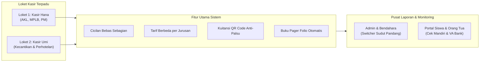

# PROPOSAL PENAWARAN PENGADAAN SISTEM
## SISTEM INFORMASI TAGIHAN & MANAJEMEN PEMBAYARAN KEUANGAN SEKOLAH (SITAMPAN SMK)
**Nomor Dokumen:** 042/PROP-IBC/SMK-FIN/X/2026  
**Penyedia Solusi:** CV. ISTANA BARCODE COMPUTER — DEVELOPER CERDAS  
**Kualifikasi Usaha:** Solusi Barcode Scanner, Mesin Kasir POS, Komputer Sekolah, Software Keuangan & Smart CCTV  

---

**Kepada Yth.**  
**Bapak / Ibu Kepala SMK & Pengurus Yayasan Pendidikan**  
Di Tempat  

Dengan hormat,  
Seiring dengan meningkatnya kompleksitas pengelolaan keuangan di Sekolah Menengah Kejuruan (SMK) yang memiliki beragam program keahlian dan volume transaksi harian yang tinggi, ketepatan pencatatan, transparansi kas, dan efisiensi waktu pelayanan di loket Tata Usaha (TU) menjadi faktor krusial bagi kredibilitas institusi pendidikan.

Bersama ini, **CV. ISTANA BARCODE COMPUTER — DEVELOPER CERDAS** bermaksud mengajukan proposal penawaran implementasi aplikasi sistem keuangan modern: **SITAMPAN SMK (Versi 2.0 Multi-Jurusan & Multi-Kasir)**.

---

## 1. LATAR BELAKANG & PERMASALAHAN OPERASIONAL SMK

Pengelolaan keuangan SMK secara manual atau konvensional seringkali menghadapi kendala operasional berikut:
1. **Penumpukan Antrean di Loket TU:** Satu meja kasir menangani seluruh siswa dari berbagai tingkatan kelas dan jurusan, menyebabkan antrean panjang terutama saat masa awal semester atau menjelang ujian.
2. **Karakteristik Pembayaran Nyicil / Bertahap:** Sebagian besar orang tua siswa membayar biaya besar (SPI/Uang Gedung, Daftar Ulang, Praktek Kejuruan) secara dicicil dengan nominal tidak menentu, yang rentan memicu selisih pembukuan pada kartu manual.
3. **Perbedaan Tarif Tiap Jurusan:** Biaya praktek jurusan Pariwisata (Kecantikan & Perhotelan) berbeda dengan jurusan Bisnis Manajemen (Akuntansi, MPLB, Pemasaran). Sistem manual sering salah menerapkan tarif.
4. **Rekapitulasi Buku Pager Memakan Waktu Berhari-hari:** Pembuatan rekapitulasi setoran kelas format folio yang diminta pengawas atau kepala sekolah butuh waktu berhari-hari jika direkap manual.

---

## 2. SOLUSI UNGGULAN: SITAMPAN SMK

Aplikasi SITAMPAN SMK menghadirkan solusi menyeluruh yang dirancang spesifik untuk ekosistem SMK:

### Keunggulan Kompetitif Sistem:
* **Pembagian 2 Kasir Kelompok Terisolasi:** Kasir Hana khusus melayani Bisnis Manajemen (`AKL`, `MPLB`, `PM`), dan Kasir Umi khusus melayani Pariwisata (`Kecantikan & Spa`, `Perhotelan`). Pembukuan kasir tidak dapat saling intip atau tertukar.
* **Fitur Cicilan Fleksibel (Nyicil Bebas):** Orang tua bebas membayar berapa pun (misal: titip Rp 150.000 atau Rp 500.000), sistem otomatis menghitung sisa saldo dan membagi alokasi pos tagihan secara akurat.
* **Kuitansi Sah Berbasis QR Code:** Setiap kuitansi tercetak memiliki kode verifikasi unik QR Code yang dapat dipindai untuk membuktikan validitas transaksi.
* **Buku Pager Cetak Folio & Ekspor Excel:** Format tabel rekapitulasi setoran kelas sudah sesuai dengan standar folio bendahara sekolah, siap diekspor ke Microsoft Excel dalam 1 detik.
* **Hak Akses Lengkap Bertingkat:** Memisahkan wewenang antara Admin Pusat, Bendahara Sekolah, Kepala Sekolah, Kasir Loket, Wali Kelas, dan Siswa/Orang Tua.

---

## 3. PAKET INVESTASI & SKEMA PENAWARAN HARGA

Kami menyediakan 3 pilihan skema pengadaan yang fleksibel sesuai anggaran dan infrastruktur sekolah:

### PILIHAN A: Paket Beli Putus (Lisensi Permanen / One-Time Purchase)
*Sangat direkomendasikan untuk kepemilikan aset perangkat lunak mandiri sekolah.*
* **Investasi:** **Rp 17.500.000,-** *(Satu Kali Bayar untuk Selamanya)*
* **Fasilitas Termasuk:**
  * Lisensi penuh aplikasi SITAMPAN SMK tanpa batasan jumlah siswa/tahun ajaran.
  * Pemasangan di server lokal sekolah (Localhost / LAN Offline) atau Cloud VPS sekolah.
  * Migrasi dan input data awal siswa, kelas, dan tarif jurusan.
  * Pelatihan intensif staf kasir TU, admin, bendahara, dan wali kelas (2 hari).
  * **Garansi Teknis & Pemeliharaan Bebas Biaya selama 12 Bulan (1 Tahun).**
  * Bebas biaya langganan bulanan maupun tahunan selamanya.

---

### PILIHAN B: Paket Sewa Kelola Cloud (Managed SaaS / Per Tahun)
*Solusi praktis tanpa repot menyediakan server lokal mandiri.*
* **Investasi:** **Rp 4.750.000,- / Tahun**
* **Fasilitas Termasuk:**
  * Cloud Server berkecepatan tinggi dengan uptime 99.8%.
  * Alamat domain resmi sekolah (contoh: `spp.smksekolah.sch.id`).
  * Backup data otomatis harian ke cloud storage terenkripsi.
  * Pembaruan fitur & update sistem berkala secara gratis.
  * Pendampingan kendala teknis prioritas via Remote & WhatsApp.

---

### PILIHAN C: Paket Bundling Hardware Kasir POS Lengkap
*Disediakan langsung oleh divisi hardware CV. ISTANA BARCODE COMPUTER.*
* **Investasi Tambahan (Opsional):** **Rp 5.250.000,- per Loket Kasir**
* **Perangkat Keras yang Didapat:**
  * 1 Unit Printer Thermal Kasir 80mm High-Speed Auto-Cutter (USB/LAN).
  * 1 Unit Omni-Directional 2D Barcode & QR Code Scanner (Pindai kuitansi & kartu siswa).
  * 1 Unit Cash Drawer (Laci Uang Otomatis Besi 5 Kertas + 8 Koin RJ-11).
  * Garansi ganti baru hardware selama 1 tahun dari CV. Istana Barcode Computer.

---

## 4. JADWAL PELAKSANAAN IMPLEMENTASI (TIMELINE)

Proses penerapan sistem berlangsung selama **7 s/d 14 hari kerja**:

| Tahap | Aktivitas Utama | Estimasi Waktu |
| :---: | :--- | :---: |
| **I** | Penandatanganan MoU & Pengumpulan Data Awal (Siswa, Rombel, Master Tarif) | Hari ke-1 s/d 3 |
| **II** | Setup Konfigurasi Sistem, KOP Sekolah, dan Akun Kasir (Hana & Umi) | Hari ke-4 s/d 6 |
| **III** | Uji Coba Transaksi Loket & Simulasi Cetak Kuitansi / Buku Pager | Hari ke-7 s/d 8 |
| **IV** | Pelatihan Staf Kasir TU, Bendahara, dan Admin Sekolah | Hari ke-9 s/d 10 |
| **V** | *Go-Live* (Sistem Beroperasi Penuh Melayani Pembayaran Siswa) | Hari ke-11 s/d 14 |

---

## 5. KETENTUAN PEMBAYARAN & KERJA SAMA

1. **Termin Pembayaran Paket Beli Putus:**
   * Uang Muka (DP): 40% pada saat penandatanganan Surat Perintah Kerja (SPK).
   * Termin II: 40% setelah instalasi dan pengujian sistem selesai.
   * Pelunasan: 20% setelah pelatihan staf dan serah terima dokumen operasional.
2. **Kustomisasi Khusus:** Apabila sekolah memerlukan integrasi WhatsApp Gateway notifikasi kuitansi otomatis ke ponsel orang tua atau integrasi Bank Virtual Account H2H (Host-to-Host), dapat dilakukan addendum penyesuaian.

---

## 6. PENUTUP

Demikian proposal penawaran implementasi **SITAMPAN SMK** ini kami sampaikan. Kami yakin sistem ini akan meningkatkan efisiensi kerja staf tata usaha, meniadakan selisih kas, serta memberikan citra profesional bagi sekolah di mata orang tua siswa dan masyarakat.

Atas perhatian, kepercayaan, dan kerja sama yang baik dari Bapak/Ibu pimpinan sekolah, kami ucapkan terima kasih.

Hormat kami,  
**CV. ISTANA BARCODE COMPUTER — DEVELOPER CERDAS**

*(Tanda Tangan & Cap Perusahaan)*  

**Marketing & Solutions Consultant**  
Divisi Software & EduTech Solutions
